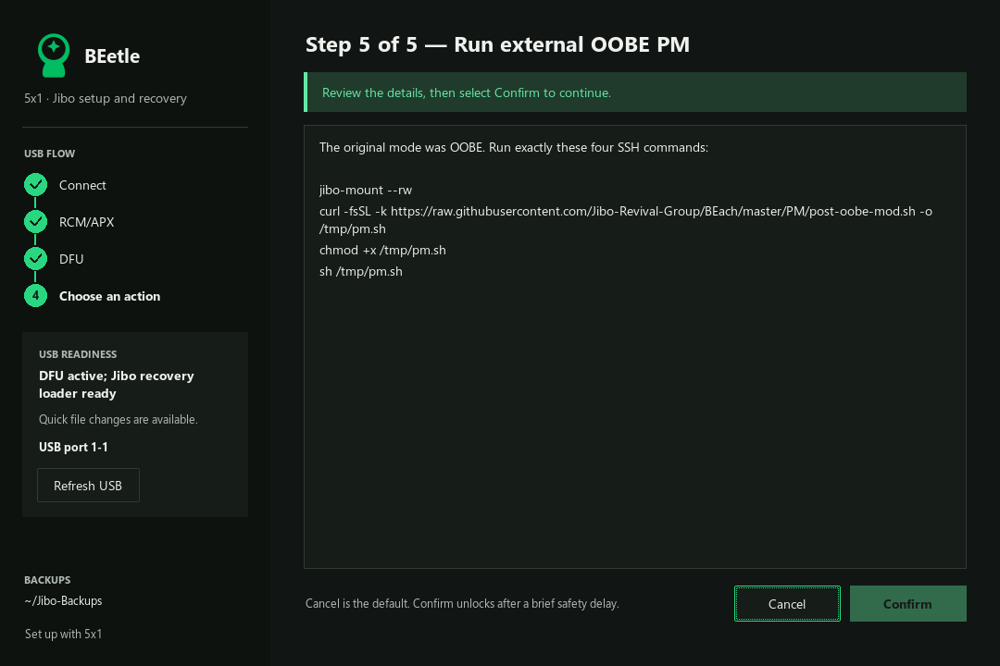

# Guided setup and external PM

BEetle opens a guided wizard. Advanced recovery tools remain available from the
welcome page. The GUI, TUI and `setup-5x1` CLI use the same flow.

1. Connect Jibo using a micro-USB data cable. Follow the wizard's RCM instructions;
   it detects RCM and loads the RAM DFU program after review.
2. Save rollback backups and record the live original mode before changing it.
   A fresh var snapshot prevents older reused backups from misclassifying OOBE. Enter
   Wi-Fi details. The wizard writes `int-developer`, Wi-Fi and the boot-screen
   IP display in one full var transaction with rollback and readback verification.
3. Power-cycle out of recovery. Wait for Wi-Fi and read the IP on Jibo's screen.
   Some unrecognized stock renderer versions retain the stock screen; use your
   router's device list if the diagnostic cannot display an IP on that version.
4. Enter the displayed IP and SSH credentials (defaults `root` /
   `jibo`). Accept the host fingerprint. Identity is compared with the USB backup
   through read-only SFTP; the installer uploads no worker or scripts.
5. Review and run the appropriate external PM sequence below. PM owns provisioning,
   installation, configuration, firmware, normal mode and reboot. Its output
   streams into the wizard.

The wizard runs normal PM for provisioned robots. Robots originally in OOBE
(`oobe` or the intermediate `identified` state) use the GitHub OOBE script.
It does not guess OOBE from missing credentials or the temporary
`int-developer` mode.

## Exact SSH sequence

For provisioned robots:

```sh
jibo-mount --rw
curl -fsSL -k https://scripts.5x1.com/pm -o /tmp/pm.sh
chmod +x /tmp/pm.sh
sh /tmp/pm.sh
```

For OOBE, BEetle changes only the curl URL:

```sh
jibo-mount --rw
curl -fsSL -k https://raw.githubusercontent.com/Jibo-Revival-Group/BEach/master/PM/post-oobe-mod.sh -o /tmp/pm.sh
chmod +x /tmp/pm.sh
sh /tmp/pm.sh
```

Those are the only SSH shell commands the wizard executes. They are sent
individually, in order, without prefixes, wrappers or added commands. A failed
command stops the sequence. No PM code, CA bundle, BEam archive, provisioning API
client, OTA installer or firmware worker is embedded in the BEetle package.

The OOBE script is maintained separately in `BEach/PM/post-oobe-mod.sh`. Its
GitHub URL tracks BEach's `master` branch. BEetle itself does not publish the
script.

## Sessions and recovery

```sh
python3 scripts/install_setup_deps.py
python3 jibo_dfu.py setup-5x1 --session ~/Jibo-Backups/beetle-5x1-session.json
```

Use a separate session for each robot. Sessions store the original OOBE mode,
identity, accepted host fingerprint, backup references and progress. Passwords
and cloud credential secrets are not stored. Keep space for var, both rootfs
slots, services and skills backups. Those backups contain private robot data.

The session also records `current_var_backup`, the manifest for that fresh
pre-change var snapshot, alongside the reusable partition backup set.

Older BEetle sessions retain the original mode and backups, but repeat USB
preparation to install the IP display. Earlier preparation-only sessions resume
at SSH to run normal PM. Completed PM sessions never rerun PM.
Normal PM receives an SSH terminal so its existing `clear` command works without
changing the four commands. If SSH drops during PM, the wizard requires the
selected script's completion message before accepting the reboot. Without that
message, the outcome remains unknown; a resume checks the OOBE receipt through
SFTP for OOBE sessions and otherwise asks before retry.
A disconnect is never treated as proof of successful installation by itself.

For filesystem rollback, enter recovery and use **Advanced recovery tools →
More tools → Restore selected partitions** with the saved `backup_set`. A
filesystem rollback does not undo body-controller firmware flashed by PM.

## Validation

Tests exercise recovery entry, normal/OOBE routing, original-mode retention, mandatory
IP display, exact command order, failed downloads, host-key acceptance/change,
wrong robot identity, interrupted PM and the absence of embedded installation
code. BEach separately tests its OOBE credential and factory-preservation stages
on disposable trees. Live robot PM/reboot validation remains outstanding.


